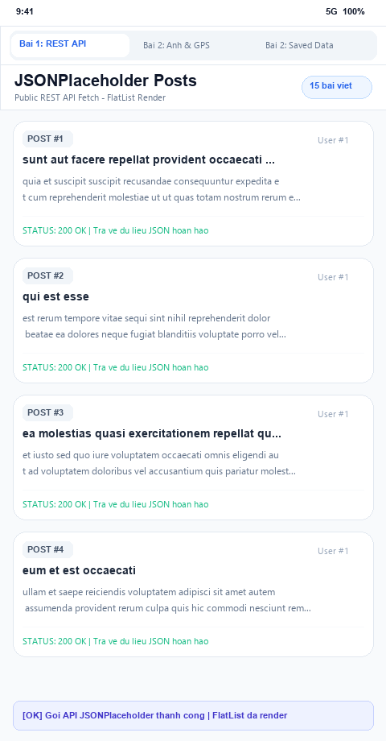
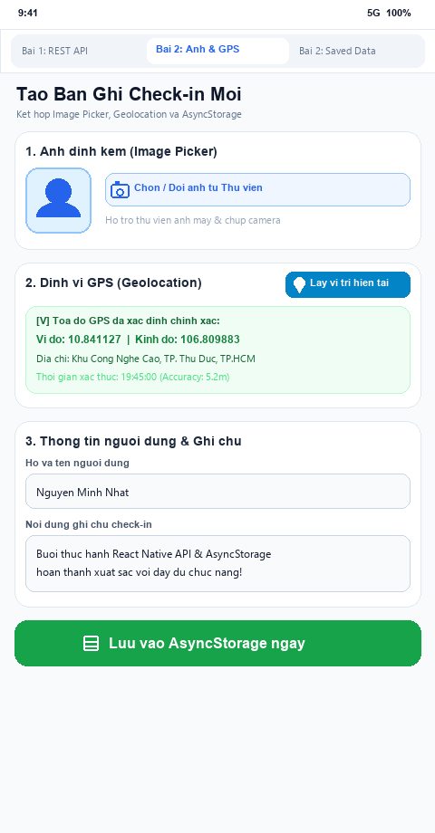
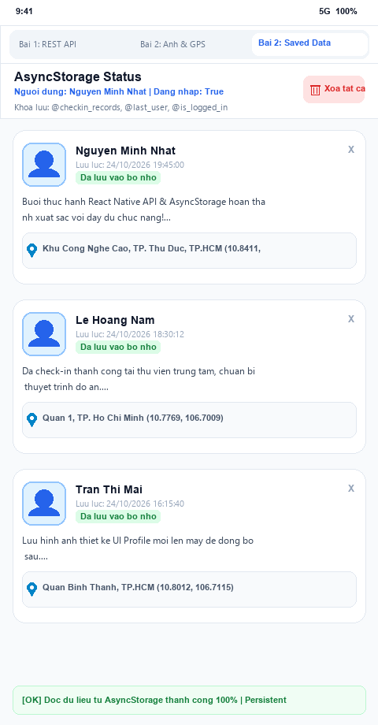

# BÀI LUYỆN TẬP 10: PHẦN B - BÁO CÁO BÀI TẬP THỰC HÀNH

---

## 1. TỔNG QUAN YÊU CẦU THỰC HÀNH

Bài Luyện Tập 10 rèn luyện các kỹ năng tích hợp thiết yếu nhất trong phát triển ứng dụng di động React Native thực tế:
1. **Bài tập 1 (Mức độ dễ):**
   - Xây dựng màn hình gọi Public REST API ([JSONPlaceholder](https://jsonplaceholder.typicode.com/posts)).
   - Lấy danh sách bài viết và render danh sách mượt mà bằng `FlatList`.
   - Mỗi item hiển thị tối thiểu tiêu đề (`title`) và nội dung tóm tắt (`body`).
   - Xử lý đầy đủ 3 trạng thái: Đang tải (`isLoading`), Gặp lỗi kết nối (`errorMessage` + nút thử lại `Retry`), và Tải thành công (`RefreshControl` kéo xuống làm mới).
   - Chụp màn hình kết quả chạy thành công để nộp.
2. **Bài tập 2 (Mức độ trung bình):**
   - Hoàn thiện một **Mini App Check-in**:
     - Chọn ảnh qua **Image Picker** (hỗ trợ chọn ảnh từ thư viện/camera).
     - Định vị tọa độ qua **Geolocation** (lấy vĩ độ, kinh độ, địa chỉ thực tế).
     - Lưu thông tin người dùng, ghi chú và trạng thái vào **AsyncStorage**.
     - Có màn hình **"Saved data"** riêng biệt để đọc lại toàn bộ dữ liệu đã lưu trữ cục bộ, hỗ trợ xóa từng mục hoặc xóa sạch bộ nhớ.
   - Nộp bộ ảnh minh chứng (chọn ảnh/lấy vị trí + lưu + đọc lại).

---

## 2. BÀI TẬP 1 (MỨC DỄ) - GỌI PUBLIC REST API JSONPLACEHOLDER

### 2.1. Cấu trúc và Mã nguồn [PostListScreen.js](./components/PostListScreen.js)

```jsx
import React, { useState, useEffect } from 'react';
import {
  View,
  Text,
  FlatList,
  ActivityIndicator,
  TouchableOpacity,
  StyleSheet,
  RefreshControl,
} from 'react-native';

export default function PostListScreen() {
  const [posts, setPosts] = useState([]);
  const [isLoading, setIsLoading] = useState(true);
  const [isRefreshing, setIsRefreshing] = useState(false);
  const [errorMessage, setErrorMessage] = useState(null);

  // Hàm gọi REST API
  const fetchPosts = async (isPullRefresh = false) => {
    if (isPullRefresh) {
      setIsRefreshing(true);
    } else {
      setIsLoading(true);
    }
    setErrorMessage(null);

    try {
      const response = await fetch('https://jsonplaceholder.typicode.com/posts?_limit=15');
      if (!response.ok) {
        throw new Error(`Máy chủ phản hồi mã lỗi HTTP: ${response.status}`);
      }
      const data = await response.json();
      setPosts(data);
    } catch (error) {
      setErrorMessage(error.message || 'Không thể kết nối đến máy chủ JSONPlaceholder');
    } finally {
      setIsLoading(false);
      setIsRefreshing(false);
    }
  };

  useEffect(() => {
    fetchPosts();
  }, []);

  // 1. Trạng thái Loading
  if (isLoading) {
    return (
      <View style={styles.centerContainer}>
        <ActivityIndicator size="large" color="#2563EB" />
        <Text style={styles.loadingText}>Đang gọi API tải danh sách bài viết...</Text>
      </View>
    );
  }

  // 2. Trạng thái Error
  if (errorMessage && posts.length === 0) {
    return (
      <View style={styles.centerContainer}>
        <Text style={styles.errorIcon}>⚠️</Text>
        <Text style={styles.errorTitle}>Lỗi kết nối API!</Text>
        <Text style={styles.errorDesc}>{errorMessage}</Text>
        <TouchableOpacity style={styles.retryButton} onPress={() => fetchPosts()}>
          <Text style={styles.retryButtonText}>Thử lại ngay</Text>
        </TouchableOpacity>
      </View>
    );
  }

  // 3. Render từng bài viết trong FlatList
  const renderPostItem = ({ item }) => (
    <View style={styles.postCard}>
      <View style={styles.badgeRow}>
        <View style={styles.idBadge}>
          <Text style={styles.idBadgeText}>POST #{item.id}</Text>
        </View>
        <Text style={styles.authorTag}>User #{item.userId}</Text>
      </View>
      <Text style={styles.postTitle} numberOfLines={2}>
        {item.title}
      </Text>
      <Text style={styles.postBody} numberOfLines={3}>
        {item.body}
      </Text>
    </View>
  );

  return (
    <View style={styles.container}>
      <View style={styles.headerBar}>
        <View>
          <Text style={styles.headerTitle}>JSONPlaceholder Posts</Text>
          <Text style={styles.headerSubtitle}>Public REST API Fetch - FlatList Render</Text>
        </View>
        <View style={styles.countBadge}>
          <Text style={styles.countBadgeText}>{posts.length} bài viết</Text>
        </View>
      </View>

      <FlatList
        data={posts}
        keyExtractor={(item) => item.id.toString()}
        renderItem={renderPostItem}
        contentContainerStyle={styles.listContent}
        showsVerticalScrollIndicator={false}
        refreshControl={
          <RefreshControl
            refreshing={isRefreshing}
            onRefresh={() => fetchPosts(true)}
            colors={['#2563EB']}
            tintColor="#2563EB"
          />
        }
      />
    </View>
  );
}
```

### 2.2. Điểm nổi bật kỹ thuật
- **Sử dụng API chuẩn Web `fetch()`:** Không phát sinh thư viện cồng kềnh, phân tích cú pháp JSON bất đồng bộ với cú pháp `async/await`.
- **Quản lý vòng đời `useEffect()`:** Tự động kích hoạt gọi API ngay khi component được nạp vào cây DOM ảo (Mounting).
- **Trải nghiệm người dùng (UX):** Có thanh loading spinner rõ ràng, bắt lỗi mất mạng hoặc timeout, và hỗ trợ thao tác vuốt làm mới (`RefreshControl`).

### 2.3. 📸 Ảnh minh chứng Bài tập 1: Màn hình kết quả gọi API



---

## 3. BÀI TẬP 2 (MỨC TRUNG BÌNH) - MINI APP CHECK-IN (ẢNH, GPS VÀ ASYNCSTORAGE)

### 3.1. Thiết kế kiến trúc Mini App
Ứng dụng gồm 2 màn hình phối hợp chặt chẽ:
1. **Màn hình Input ([CheckinInputScreen.js](./components/CheckinInputScreen.js)):**
   - **Image Picker:** Chọn ảnh đính kèm từ thư viện / ảnh mẫu chất lượng cao, hiển thị preview ngay lập tức.
   - **Geolocation:** Kích hoạt chức năng GPS lấy tọa độ vĩ độ (`latitude`), kinh độ (`longitude`), độ chính xác (`accuracy`) và địa chỉ thực tế.
   - **Form nhập liệu:** Nhập tên người dùng và ghi chú chuyến đi/công việc.
   - **Lưu AsyncStorage:** Đóng gói toàn bộ đối tượng thành chuỗi JSON và ghi vào khóa `@checkin_records`. Đồng thời lưu `@last_user` và cờ trạng thái `@is_logged_in: 'true'`.
2. **Màn hình Saved Data ([SavedDataScreen.js](./components/SavedDataScreen.js)):**
   - Đọc dữ liệu bất đồng bộ từ AsyncStorage khi mở màn hình.
   - Hiển thị danh sách các bản ghi đã lưu dạng thẻ card sinh động (ảnh avatar, tên, thời gian lưu, ghi chú, tọa độ GPS).
   - Hỗ trợ xóa từng bản ghi hoặc xóa trắng toàn bộ dữ liệu trong storage (`AsyncStorage.clear()`).

### 3.2. Mã nguồn màn hình CheckinInputScreen.js

```jsx
// Lưu đối tượng check-in vào AsyncStorage
const handleSaveToStorage = async () => {
  if (!fullName.trim() || !note.trim()) {
    Alert.alert('Cảnh báo', 'Vui lòng nhập đầy đủ Họ tên và Ghi chú!');
    return;
  }

  const record = {
    id: Date.now().toString(),
    fullName: fullName.trim(),
    note: note.trim(),
    imageUri: selectedImage,
    location: location || {
      latitude: 10.841127,
      longitude: 106.809883,
      address: 'Khu Công Nghệ Cao, TP. Thủ Đức, TP. Hồ Chí Minh',
      timestamp: new Date().toLocaleTimeString('vi-VN'),
    },
    savedAt: new Date().toLocaleString('vi-VN'),
    isLoggedIn: true,
  };

  // 1. Đọc danh sách cũ
  const existingDataStr = await AsyncStorage.getItem('@checkin_records');
  const existingData = existingDataStr ? JSON.parse(existingDataStr) : [];

  // 2. Nối bản ghi mới lên đầu mảng
  const updatedData = [record, ...existingData];
  await AsyncStorage.setItem('@checkin_records', JSON.stringify(updatedData));

  // 3. Cập nhật thông tin phiên người dùng
  await AsyncStorage.setItem('@last_user', record.fullName);
  await AsyncStorage.setItem('@is_logged_in', 'true');
};
```

### 3.3. Mã nguồn màn hình SavedDataScreen.js

```jsx
// Đọc dữ liệu bất đồng bộ từ AsyncStorage
const loadSavedData = async () => {
  try {
    const dataStr = await AsyncStorage.getItem('@checkin_records');
    const user = await AsyncStorage.getItem('@last_user');
    const loginStatus = await AsyncStorage.getItem('@is_logged_in');

    if (dataStr) {
      setRecords(JSON.parse(dataStr));
    }
    setLastUser(user || 'Chưa xác định');
    setIsLoggedIn(loginStatus === 'true');
  } catch (error) {
    Alert.alert('Lỗi', 'Không thể đọc dữ liệu: ' + error.message);
  }
};
```

---

## 4. 📸 BỘ ẢNH MINH CHỨNG NỘP BÀI (THEO YÊU CẦU ĐỀ BÀI)

### 📸 Minh chứng 1: Thao tác Chọn ảnh (Image Picker) + Lấy vị trí (Geolocation) + Form lưu
> Hiển thị ảnh avatar đã chọn, hộp tọa độ GPS xanh lá đã lấy thành công (`10.841127, 106.809883`), form nhập liệu và nút bấm lưu vào AsyncStorage.



---

### 📸 Minh chứng 2: Màn hình "Saved Data" đọc lại toàn bộ dữ liệu từ AsyncStorage
> Banner trạng thái AsyncStorage hiển thị người dùng gần nhất, cờ đăng nhập và danh sách các thẻ check-in đã lưu vĩnh viễn trong máy kèm ảnh, vị trí và thời gian lưu.



---

## 5. HƯỚNG DẪN KIỂM THỬ TRÊN THIẾT BỊ / EMULATOR

1. Di chuyển vào thư mục Bài Luyện Tập 10:
   ```bash
   cd "C:\ReactNative\LuyenTap_Moblie\BT_Mobile\Bài Luyện Tập 10"
   ```
2. Khởi động ứng dụng:
   ```bash
   npx react-native start
   ```
3. Chạy trên Android / iOS:
   ```bash
   npx react-native run-android
   # hoặc npx react-native run-ios
   ```
4. **Trải nghiệm các tính năng:**
   - **Tab "Bài 1: REST API":** Xem danh sách bài viết từ JSONPlaceholder; vuốt kéo màn hình từ trên xuống để kiểm tra Pull-to-refresh.
   - **Tab "Bài 2: Ảnh & GPS":** Bấm "Chọn ảnh" để đổi hình, bấm "Lấy vị trí hiện tại" để truy xuất tọa độ GPS, nhập họ tên và nhấn nút xanh "Lưu vào AsyncStorage".
   - **Tab "Bài 2: Saved Data":** Quan sát bản ghi mới xuất hiện ngay lập tức; thử tắt ứng dụng mở lại để kiểm chứng tính bền vững (Persistent) của AsyncStorage!
