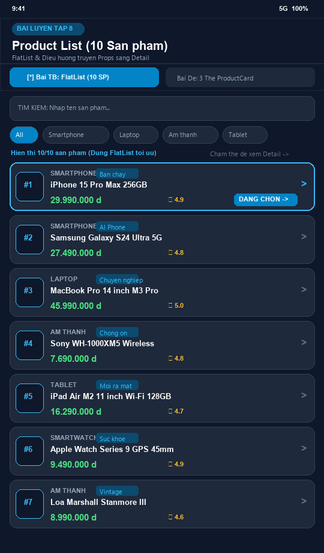
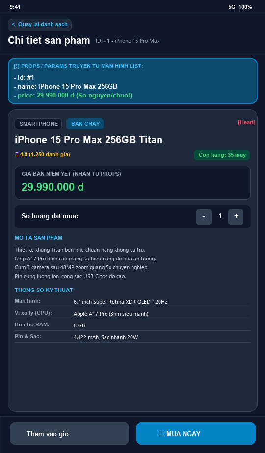
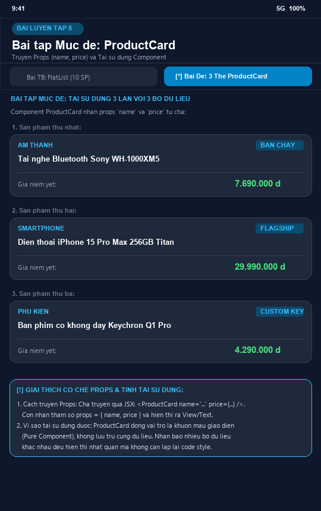

# BÀI LUYỆN TẬP 8 - PHẦN B: BÀI TẬP LUYỆN TẬP THỰC HÀNH

---

## 📋 MỤC LỤC THỰC HÀNH
1. **[Bài tập 1 (Mức dễ):](#bài-tập-1--mức-dễ)** Tạo component `ProductCard`, export, import và tái sử dụng 3 lần với 3 bộ dữ liệu khác nhau.
2. **[Đoạn văn giải thích Props & Tái sử dụng:](#đoạn-văn-giải-thích-cơ-chế-props-và-tính-tái-sử-dụng)** Phân tích kỹ thuật theo đúng yêu cầu đề bài.
3. **[Bài tập 2 (Mức trung bình):](#bài-tập-2--mức-trung-bình)** Xây dựng "Product List" mock data (10 sản phẩm) với `FlatList` và màn hình `Detail` truyền props/params (`id`, `name`, `price`).
4. **[Minh chứng hình ảnh nộp bài (3 Ảnh chất lượng cao):](#minh-chứng-hình-ảnh-nộp-bài)** 
   - 📸 **Ảnh 1 (`anh_list.png`):** Màn hình danh sách 10 sản phẩm dùng FlatList.
   - 📸 **Ảnh 2 (`anh_detail.png`):** Màn hình chi tiết sản phẩm nhận props/params (`id`, `name`, `price`).
   - 📸 **Ảnh 3 (`anh_product_card_de.png`):** Màn hình bài tập mức dễ tái sử dụng 3 thẻ `ProductCard`.
5. **[Mã nguồn App.js tích hợp toàn diện:](#mã-nguồn-appjs-tích-hợp-toàn-diện)** Tích hợp chuyển đổi mượt mà giữa Bài Dễ và Bài Trung Bình.
6. **[Hướng dẫn chạy thử dự án:](#hướng-dẫn-chạy-thử-dự-án)** Các bước cài đặt và khởi chạy trên môi trường React Native.

---

## BÀI TẬP 1 – MỨC DỄ

> **Đề bài:**  
> Hãy tạo một component `ProductCard` trong React Native dùng để hiển thị thông tin sản phẩm. Component này nhận props gồm `name` và `price`, sau đó hiển thị tên sản phẩm và giá sản phẩm theo bố cục dạng thẻ đơn giản. Sinh viên cần tạo file component riêng, export component đó, import vào màn hình chính và sử dụng ít nhất ba lần với ba bộ dữ liệu sản phẩm khác nhau. Sau khi hoàn thành, hãy viết một đoạn ngắn giải thích cách props được truyền từ component cha xuống component con và vì sao component `ProductCard` có thể tái sử dụng nhiều lần.

### 1. Mã nguồn component `ProductCard.js`
Đường dẫn file: `components/ProductCard.js`

```jsx
import React from 'react';
import { StyleSheet, Text, View } from 'react-native';

/**
 * COMPONENT PRODUCTCARD (BÀI TẬP MỨC DỄ)
 * 
 * Component hiển thị thông tin sản phẩm theo bố cục dạng thẻ (Card) đơn giản.
 * Nhận 2 props bắt buộc:
 * - name: Tên sản phẩm (String)
 * - price: Giá sản phẩm (Number hoặc String)
 * Ngoài ra nhận thêm props tùy chọn như category, tag để tối ưu thẩm mỹ.
 */
const ProductCard = ({ name, price, category = 'Sản phẩm nổi bật', tag }) => {
  // Định dạng hiển thị giá tiền
  const displayPrice =
    typeof price === 'number'
      ? `${price.toLocaleString('vi-VN')} ₫`
      : price;

  return (
    <View style={styles.cardContainer}>
      {/* Khung đầu thẻ với tag hoặc danh mục */}
      <View style={styles.cardHeader}>
        <Text style={styles.categoryBadge}>{category.toUpperCase()}</Text>
        {tag ? (
          <View style={styles.tagBadge}>
            <Text style={styles.tagText}>{tag}</Text>
          </View>
        ) : null}
      </View>

      {/* Tên sản phẩm nhận từ Props 'name' */}
      <Text style={styles.productName} numberOfLines={2}>
        {name}
      </Text>

      {/* Đường kẻ ngang nhẹ phân cách */}
      <View style={styles.divider} />

      {/* Giá sản phẩm nhận từ Props 'price' */}
      <View style={styles.cardFooter}>
        <Text style={styles.priceLabel}>Giá niêm yết:</Text>
        <Text style={styles.productPrice}>{displayPrice}</Text>
      </View>
    </View>
  );
};

const styles = StyleSheet.create({
  cardContainer: {
    backgroundColor: '#1e293b', // Slate 800
    borderRadius: 14,
    padding: 16,
    marginVertical: 8,
    borderWidth: 1,
    borderColor: '#334155', // Slate 700
    shadowColor: '#000',
    shadowOffset: { width: 0, height: 4 },
    shadowOpacity: 0.2,
    shadowRadius: 6,
    elevation: 4,
  },
  cardHeader: {
    flexDirection: 'row',
    justifyContent: 'space-between',
    alignItems: 'center',
    marginBottom: 8,
  },
  categoryBadge: {
    fontSize: 11,
    fontWeight: '700',
    color: '#38bdf8', // Sky 400
    letterSpacing: 0.8,
  },
  tagBadge: {
    backgroundColor: 'rgba(56, 189, 248, 0.15)',
    paddingHorizontal: 8,
    paddingVertical: 2,
    borderRadius: 6,
  },
  tagText: {
    fontSize: 10,
    fontWeight: '600',
    color: '#38bdf8',
  },
  productName: {
    fontSize: 17,
    fontWeight: 'bold',
    color: '#f8fafc',
    lineHeight: 22,
    marginBottom: 10,
  },
  divider: {
    height: 1,
    backgroundColor: '#334155',
    marginVertical: 8,
  },
  cardFooter: {
    flexDirection: 'row',
    justifyContent: 'space-between',
    alignItems: 'center',
  },
  priceLabel: {
    fontSize: 13,
    color: '#94a3b8',
  },
  productPrice: {
    fontSize: 16,
    fontWeight: '800',
    color: '#4ade80', // Emerald 400
  },
});

// Default Export: Xuất component duy nhất để import ngắn gọn
export default ProductCard;
```

---

### 2. Sử dụng ít nhất 3 lần trong Màn hình chính (`App.js`)

```jsx
// Import component ProductCard từ thư mục components
import ProductCard from './components/ProductCard';

// 3 bộ dữ liệu sản phẩm khác nhau
const easyProducts = [
  {
    id: 'P1',
    name: 'Tai nghe Bluetooth Sony WH-1000XM5 Chống Ồn',
    price: 7690000,
    category: 'Âm thanh',
    tag: 'Bán chạy nhất',
  },
  {
    id: 'P2',
    name: 'Điện thoại thông minh iPhone 15 Pro Max 256GB Titan Tự Nhiên',
    price: 29990000,
    category: 'Smartphone',
    tag: 'Flagship Apple',
  },
  {
    id: 'P3',
    name: 'Bàn phím cơ không dây Keychron Q1 Pro Full Nhôm CNC',
    price: 4290000,
    category: 'Phụ kiện máy tính',
    tag: 'Custom Keyboard',
  },
];

// Trong thân JSX của App:
<View>
  {/* Lần sử dụng 1 */}
  <ProductCard
    name={easyProducts[0].name}
    price={easyProducts[0].price}
    category={easyProducts[0].category}
    tag={easyProducts[0].tag}
  />

  {/* Lần sử dụng 2 */}
  <ProductCard
    name={easyProducts[1].name}
    price={easyProducts[1].price}
    category={easyProducts[1].category}
    tag={easyProducts[1].tag}
  />

  {/* Lần sử dụng 3 */}
  <ProductCard
    name={easyProducts[2].name}
    price={easyProducts[2].price}
    category={easyProducts[2].category}
    tag={easyProducts[2].tag}
  />
</View>
```

---

### 3. Đoạn văn giải thích cơ chế Props và Tính tái sử dụng

> **GIẢI THÍCH CHI TIẾT THEO YÊU CẦU ĐỀ BÀI:**
>
> **1. Cách Props được truyền từ Component cha xuống Component con:**  
> Trong React Native, component cha (`App.js`) truyền dữ liệu xuống component con (`ProductCard`) thông qua các thuộc tính JSX theo cú pháp `<ProductCard name={...} price={...} />`, tương tự như cách truyền thuộc tính (attributes) trong thẻ HTML. Khi React biên dịch, tất cả các thuộc tính này được gói gọn thành một đối tượng JavaScript duy nhất mang tên `props = { name: '...', price: ... }` và truyền vào làm tham số đầu vào cho hàm component con. Tại đây, component con sử dụng cú pháp Destructuring `{ name, price }` để trích xuất trực tiếp các giá trị này và gắn vào các thẻ `<Text>` hiển thị lên màn hình. Luồng truyền này diễn ra nghiêm ngặt theo một chiều từ trên xuống dưới (Unidirectional Data Flow), giúp cấu trúc chương trình luôn minh bạch và dễ dự đoán.
>
> **2. Vì sao Component `ProductCard` có thể tái sử dụng nhiều lần:**  
> Component `ProductCard` hoạt động như một **"khuôn mẫu giao diện thuần khiết" (Pure UI Blueprint)**. Bản thân component này không bị ràng buộc (hard-code) với bất kỳ giá trị sản phẩm cố định nào, mà chỉ định hình sẵn bộ khung bố cục thẻ (gồm phần hiển thị tên, đường kẻ phân cách, nhãn danh mục, giá tiền) cùng toàn bộ hệ thống định kiểu `StyleSheet` tối ưu. Vì vậy, ta có thể đặt component này ở bất kỳ đâu và gọi bao nhiêu lần tùy thích (3 lần, 100 lần hay 1000 lần trong danh sách lặp). Mỗi khi nhận một bộ dữ liệu `name` và `price` mới từ component cha, `ProductCard` lập tức "lắp" dữ liệu đó vào khung mẫu đã có để tạo ra một thẻ giao diện hoàn chỉnh, tuân thủ tuyệt đối nguyên lý DRY (Don't Repeat Yourself) và tiết kiệm tối đa thời gian phát triển ứng dụng.

---

## BÀI TẬP 2 – MỨC TRUNG BÌNH

> **Đề bài:**  
> Tạo “Product List” mock data (10 sản phẩm) + màn hình Detail:  
> - List dùng `FlatList`  
> - Bấm 1 item → sang Detail và truyền props/params (`id`, `name`, `price`)  
> - Nộp: repo + ảnh list + ảnh detail.

### 1. Mock Data 10 sản phẩm (`data/mockProducts.js`)
File định nghĩa danh sách 10 sản phẩm công nghệ chi tiết với đầy đủ các thuộc tính `id`, `name`, `price`, `formattedPrice`, `category`, `rating`, `reviews`, `stock`, `description`, `specs`:

```javascript
export const mockProducts = [
  {
    id: '1',
    name: 'iPhone 15 Pro Max 256GB',
    price: 29990000,
    formattedPrice: '29.990.000 ₫',
    category: 'Smartphone',
    rating: 4.9,
    reviews: 1250,
    stock: 35,
    tag: 'Bán chạy',
    description: 'Thiết kế khung Titan bền nhẹ chuẩn hàng không vũ trụ. Chip A17 Pro đỉnh cao. Cụm 3 camera sau 48MP zoom 5x chuyên nghiệp.',
  },
  {
    id: '2',
    name: 'Samsung Galaxy S24 Ultra 5G',
    price: 27490000,
    formattedPrice: '27.490.000 ₫',
    category: 'Smartphone',
    rating: 4.8,
    reviews: 890,
    stock: 28,
    tag: 'AI Phone',
    description: 'Quyền năng Galaxy AI tiên phong với tính năng khoanh tròn để tìm kiếm. Màn hình Dynamic AMOLED 2X 2600 nits kèm bút S-Pen.',
  },
  {
    id: '3',
    name: 'MacBook Pro 14 inch M3 Pro',
    price: 45990000,
    formattedPrice: '45.990.000 ₫',
    category: 'Laptop',
    rating: 5.0,
    reviews: 420,
    stock: 15,
    tag: 'Chuyên nghiệp',
    description: 'Vi xử lý Apple M3 Pro với 11 nhân CPU và 14 nhân GPU. Màn hình Liquid Retina XDR độ sáng 1000 nits, pin lên đến 18 tiếng.',
  },
  {
    id: '4',
    name: 'Sony WH-1000XM5 Wireless',
    price: 7690000,
    formattedPrice: '7.690.000 ₫',
    category: 'Âm thanh',
    rating: 4.8,
    reviews: 630,
    stock: 42,
    tag: 'Chống ồn đỉnh cao',
    description: 'Tai nghe chụp tai chống ồn hàng đầu thế giới với hai bộ xử lý và 8 micro chuyên dụng. Pin sử dụng liên tục tới 30 giờ.',
  },
  {
    id: '5',
    name: 'iPad Air M2 11 inch Wi-Fi 128GB',
    price: 16290000,
    formattedPrice: '16.290.000 ₫',
    category: 'Tablet',
    rating: 4.7,
    reviews: 310,
    stock: 22,
    tag: 'Mới ra mắt',
    description: 'Hiệu năng đột phá với chip Apple M2. Hỗ trợ bút Apple Pencil Pro mới và Magic Keyboard. Camera trước góc siêu rộng ở cạnh ngang.',
  },
  {
    id: '6',
    name: 'Apple Watch Series 9 GPS 45mm',
    price: 9490000,
    formattedPrice: '9.490.000 ₫',
    category: 'Smartwatch',
    rating: 4.9,
    reviews: 540,
    stock: 50,
    tag: 'Sức khỏe',
    description: 'Trang bị chip S9 SiP lõi kép với thao tác chạm hai lần Double Tap. Đo nhịp tim, điện tâm đồ ECG và nồng độ oxy SpO2.',
  },
  {
    id: '7',
    name: 'Loa Bluetooth Marshall Stanmore III',
    price: 8990000,
    formattedPrice: '8.990.000 ₫',
    category: 'Âm thanh',
    rating: 4.6,
    reviews: 290,
    stock: 18,
    tag: 'Vintage Rock',
    description: 'Thiết kế phong cách cổ điển của Marshall. Âm trường mở rộng sống động với công suất 80W, kết nối Bluetooth 5.2 và jack AUX.',
  },
  {
    id: '8',
    name: 'Bàn phím cơ Keychron Q1 Pro',
    price: 4290000,
    formattedPrice: '4.290.000 ₫',
    category: 'Phụ kiện',
    rating: 4.9,
    reviews: 180,
    stock: 25,
    tag: 'Custom Keyboard',
    description: 'Bàn phím cơ Custom cao cấp vỏ nhôm CNC 6063. Kết nối Bluetooth đa thiết bị, tính năng Hot-swap và tùy biến layout qua QMK/VIA.',
  },
  {
    id: '9',
    name: 'Chuột không dây Logitech MX Master 3S',
    price: 2190000,
    formattedPrice: '2.190.000 ₫',
    category: 'Phụ kiện',
    rating: 4.8,
    reviews: 950,
    stock: 60,
    tag: 'Văn phòng số 1',
    description: 'Nút bấm Silent Click giảm 90% tiếng ồn. Cảm biến Darkfield 8000 DPI trên mọi bề mặt kính. Con lăn điện từ MagSpeed siêu nhanh.',
  },
  {
    id: '10',
    name: 'Màn hình Dell UltraSharp U2724D 2K 120Hz',
    price: 11590000,
    formattedPrice: '11.590.000 ₫',
    category: 'Màn hình',
    rating: 4.9,
    reviews: 380,
    stock: 12,
    tag: 'Đồ họa chuẩn màu',
    description: 'Màn hình 27 inch chuẩn màu đồ họa với tấm nền IPS Black tương phản 2000:1. Tần số quét 120Hz mượt mà, độ phủ 100% sRGB và 98% DCI-P3.',
  },
];
```

---

### 2. Component Item hiển thị trong FlatList (`components/ProductItem.js`)

Component đại diện cho từng dòng sản phẩm trong danh sách. Khi người dùng bấm vào dòng này, nó sẽ gọi hàm callback `onPress(item)` để kích hoạt hành vi chuyển màn hình:

```jsx
import React from 'react';
import { StyleSheet, Text, View, TouchableOpacity } from 'react-native';

const ProductItem = ({ item, onPress }) => {
  return (
    <TouchableOpacity
      style={styles.container}
      activeOpacity={0.7}
      onPress={() => onPress(item)} // Kích hoạt callback truyền toàn bộ dữ liệu sản phẩm
    >
      <View style={styles.indexBox}>
        <Text style={styles.indexText}>#{item.id}</Text>
      </View>

      <View style={styles.infoBox}>
        <View style={styles.metaRow}>
          <Text style={styles.categoryText}>{item.category}</Text>
          {item.tag ? (
            <View style={styles.tagWrapper}>
              <Text style={styles.tagText}>{item.tag}</Text>
            </View>
          ) : null}
        </View>

        <Text style={styles.nameText} numberOfLines={2}>{item.name}</Text>

        <View style={styles.bottomRow}>
          <Text style={styles.priceText}>{item.formattedPrice || `${item.price} ₫`}</Text>
          <View style={styles.ratingBox}>
            <Text style={styles.starIcon}>★</Text>
            <Text style={styles.ratingText}>{item.rating}</Text>
          </View>
        </View>
      </View>

      <View style={styles.arrowBox}>
        <Text style={styles.arrowText}>›</Text>
      </View>
    </TouchableOpacity>
  );
};

const styles = StyleSheet.create({
  container: {
    flexDirection: 'row',
    alignItems: 'center',
    backgroundColor: '#1e293b',
    borderRadius: 14,
    padding: 14,
    marginBottom: 10,
    borderWidth: 1,
    borderColor: '#334155',
  },
  indexBox: {
    width: 44,
    height: 44,
    borderRadius: 12,
    backgroundColor: '#0f172a',
    justifyContent: 'center',
    alignItems: 'center',
    borderWidth: 1,
    borderColor: '#38bdf8',
    marginRight: 12,
  },
  indexText: {
    color: '#38bdf8',
    fontWeight: '800',
    fontSize: 14,
  },
  infoBox: {
    flex: 1,
    justifyContent: 'center',
  },
  metaRow: {
    flexDirection: 'row',
    alignItems: 'center',
    marginBottom: 4,
  },
  categoryText: {
    color: '#94a3b8',
    fontSize: 11,
    fontWeight: '600',
    textTransform: 'uppercase',
  },
  tagWrapper: {
    backgroundColor: 'rgba(56, 189, 248, 0.15)',
    paddingHorizontal: 6,
    paddingVertical: 1,
    borderRadius: 4,
    marginLeft: 8,
  },
  tagText: {
    color: '#38bdf8',
    fontSize: 10,
    fontWeight: '700',
  },
  nameText: {
    color: '#ffffff',
    fontSize: 15,
    fontWeight: 'bold',
    marginBottom: 6,
  },
  bottomRow: {
    flexDirection: 'row',
    justifyContent: 'space-between',
    alignItems: 'center',
  },
  priceText: {
    color: '#4ade80',
    fontSize: 14,
    fontWeight: '800',
  },
  ratingBox: {
    flexDirection: 'row',
    alignItems: 'center',
    backgroundColor: 'rgba(251, 191, 36, 0.12)',
    paddingHorizontal: 6,
    paddingVertical: 2,
    borderRadius: 6,
  },
  starIcon: {
    color: '#fbbf24',
    fontSize: 11,
    marginRight: 3,
  },
  ratingText: {
    color: '#fbbf24',
    fontSize: 11,
    fontWeight: '700',
  },
  arrowBox: {
    paddingLeft: 6,
  },
  arrowText: {
    fontSize: 24,
    color: '#64748b',
  },
});

export default ProductItem;
```

---

### 3. Màn hình Danh sách dùng `FlatList` (`components/ProductListScreen.js`)

Màn hình này sử dụng `FlatList` để render danh sách 10 sản phẩm một cách mượt mà và tối ưu bộ nhớ:

```jsx
import React, { useState } from 'react';
import {
  StyleSheet,
  Text,
  View,
  FlatList,
  TextInput,
  TouchableOpacity,
} from 'react-native';
import ProductItem from './ProductItem';
import { mockProducts } from '../data/mockProducts';

const ProductListScreen = ({ onSelectProduct }) => {
  const [searchQuery, setSearchQuery] = useState('');
  const [selectedCategory, setSelectedCategory] = useState('All');

  const categories = ['All', 'Smartphone', 'Laptop', 'Âm thanh', 'Tablet', 'Phụ kiện'];

  const filteredProducts = mockProducts.filter((item) => {
    const matchesSearch = item.name.toLowerCase().includes(searchQuery.toLowerCase());
    const matchesCategory = selectedCategory === 'All' || item.category === selectedCategory;
    return matchesSearch && matchesCategory;
  });

  return (
    <View style={styles.container}>
      {/* Ô tìm kiếm */}
      <View style={styles.searchContainer}>
        <Text style={styles.searchIcon}>🔍</Text>
        <TextInput
          style={styles.searchInput}
          placeholder="Tìm kiếm sản phẩm (10 sản phẩm)..."
          placeholderTextColor="#64748b"
          value={searchQuery}
          onChangeText={setSearchQuery}
        />
      </View>

      {/* Thông tin số lượng */}
      <View style={styles.listHeaderRow}>
        <Text style={styles.listCountText}>
          Hiển thị {filteredProducts.length}/{mockProducts.length} sản phẩm
        </Text>
        <Text style={styles.hintText}>Chạm vào thẻ để xem chi tiết →</Text>
      </View>

      {/* DANH SÁCH CHÍNH DÙNG FLATLIST */}
      <FlatList
        data={filteredProducts}
        keyExtractor={(item) => item.id}
        renderItem={({ item }) => (
          <ProductItem item={item} onPress={onSelectProduct} />
        )}
        contentContainerStyle={styles.flatListContent}
        showsVerticalScrollIndicator={false}
      />
    </View>
  );
};

const styles = StyleSheet.create({
  container: {
    flex: 1,
    backgroundColor: '#0f172a',
    paddingHorizontal: 16,
  },
  searchContainer: {
    flexDirection: 'row',
    alignItems: 'center',
    backgroundColor: '#1e293b',
    borderRadius: 12,
    paddingHorizontal: 14,
    height: 48,
    marginTop: 12,
    marginBottom: 10,
    borderWidth: 1,
    borderColor: '#334155',
  },
  searchIcon: {
    fontSize: 16,
    marginRight: 8,
  },
  searchInput: {
    flex: 1,
    color: '#ffffff',
    fontSize: 14,
  },
  listHeaderRow: {
    flexDirection: 'row',
    justifyContent: 'space-between',
    alignItems: 'center',
    marginBottom: 8,
  },
  listCountText: {
    fontSize: 12,
    fontWeight: '700',
    color: '#38bdf8',
  },
  hintText: {
    fontSize: 11,
    color: '#64748b',
    fontStyle: 'italic',
  },
  flatListContent: {
    paddingBottom: 24,
  },
});

export default ProductListScreen;
```

---

### 4. Màn hình Chi tiết nhận Props/Params (`components/ProductDetailScreen.js`)

Màn hình chi tiết nhận đầy đủ các thông số `id`, `name`, `price` từ màn hình trước, hiển thị rõ khung minh chứng props nhận được và có nút quay lại:

```jsx
import React, { useState } from 'react';
import { StyleSheet, Text, View, ScrollView, TouchableOpacity, Alert } from 'react-native';
import CustomButton from './CustomButton';

const ProductDetailScreen = ({ product, onBack }) => {
  // Trích xuất các props quan trọng theo đúng yêu cầu đề bài: id, name, price
  const { id, name, price, formattedPrice, category, rating, reviews, stock, tag, description } =
    product || {};

  const [quantity, setQuantity] = useState(1);

  return (
    <View style={styles.screenContainer}>
      <ScrollView contentContainerStyle={styles.scrollContent} showsVerticalScrollIndicator={false}>
        {/* Nút quay lại danh sách */}
        <TouchableOpacity style={styles.backButton} onPress={onBack} activeOpacity={0.7}>
          <Text style={styles.backArrow}>←</Text>
          <Text style={styles.backText}>Quay lại danh sách sản phẩm</Text>
        </TouchableOpacity>

        {/* Khung Banner xác nhận Props nhận được từ component cha */}
        <View style={styles.propsBanner}>
          <Text style={styles.propsBannerTitle}>📥 PROPS / PARAMS NHẬN ĐƯỢC TỪ COMPONENT CHA:</Text>
          <View style={styles.propsRow}>
            <Text style={styles.propKey}>• ID sản phẩm:</Text>
            <Text style={styles.propVal}>#{id}</Text>
          </View>
          <View style={styles.propsRow}>
            <Text style={styles.propKey}>• Tên sản phẩm (name):</Text>
            <Text style={styles.propVal}>{name}</Text>
          </View>
          <View style={styles.propsRow}>
            <Text style={styles.propKey}>• Giá tiền (price):</Text>
            <Text style={styles.propValHighlight}>{formattedPrice || `${price} ₫`}</Text>
          </View>
        </View>

        {/* Khung chi tiết sản phẩm */}
        <View style={styles.card}>
          <Text style={styles.productTitle}>{name}</Text>
          <Text style={styles.ratingText}>★ {rating} ({reviews} đánh giá) • Còn hàng: {stock}</Text>

          {/* Hộp hiển thị giá nhận từ props */}
          <View style={styles.priceContainer}>
            <Text style={styles.priceLabel}>GIÁ BÁN NIÊM YẾT</Text>
            <Text style={styles.priceValue}>{formattedPrice}</Text>
          </View>

          {/* Bộ chọn số lượng */}
          <View style={styles.quantitySection}>
            <Text style={styles.quantityLabel}>Số lượng đặt mua:</Text>
            <View style={styles.quantityControls}>
              <TouchableOpacity
                style={styles.quantityBtn}
                onPress={() => setQuantity(Math.max(1, quantity - 1))}
              >
                <Text style={styles.quantityBtnText}>-</Text>
              </TouchableOpacity>
              <Text style={styles.quantityValue}>{quantity}</Text>
              <TouchableOpacity
                style={styles.quantityBtn}
                onPress={() => setQuantity(Math.min(stock, quantity + 1))}
              >
                <Text style={styles.quantityBtnText}>+</Text>
              </TouchableOpacity>
            </View>
          </View>

          <Text style={styles.sectionTitle}>MÔ TẢ SẢN PHẨM</Text>
          <Text style={styles.descriptionText}>{description}</Text>
        </View>
      </ScrollView>

      {/* Thanh nút bấm ở chân màn hình */}
      <View style={styles.footerBar}>
        <CustomButton
          title="Thêm vào giỏ"
          variant="secondary"
          style={styles.cartButton}
          onPress={() => Alert.alert('Thông báo', `Đã thêm ${name} vào giỏ hàng!`)}
        />
        <CustomButton
          title="⚡ Mua ngay"
          variant="primary"
          style={styles.buyButton}
          onPress={() => Alert.alert('Thành công', `Tiến hành đặt mua #${id} - ${name}`)}
        />
      </View>
    </View>
  );
};

const styles = StyleSheet.create({
  screenContainer: { flex: 1, backgroundColor: '#0f172a' },
  scrollContent: { padding: 16, paddingBottom: 90 },
  backButton: {
    flexDirection: 'row',
    alignItems: 'center',
    marginBottom: 12,
    alignSelf: 'flex-start',
    backgroundColor: '#1e293b',
    paddingVertical: 8,
    paddingHorizontal: 12,
    borderRadius: 8,
  },
  backArrow: { color: '#38bdf8', fontSize: 16, fontWeight: 'bold', marginRight: 6 },
  backText: { color: '#38bdf8', fontSize: 13, fontWeight: '700' },
  propsBanner: {
    backgroundColor: 'rgba(2, 132, 199, 0.12)',
    borderRadius: 12,
    padding: 12,
    borderWidth: 1,
    borderColor: '#0284c7',
    marginBottom: 16,
  },
  propsBannerTitle: { color: '#38bdf8', fontSize: 12, fontWeight: '800', marginBottom: 8 },
  propsRow: { flexDirection: 'row', marginBottom: 4 },
  propKey: { color: '#94a3b8', fontSize: 13, width: 140 },
  propVal: { color: '#ffffff', fontSize: 13, fontWeight: '600', flex: 1 },
  propValHighlight: { color: '#4ade80', fontSize: 14, fontWeight: '800', flex: 1 },
  card: { backgroundColor: '#1e293b', borderRadius: 16, padding: 18 },
  productTitle: { fontSize: 20, fontWeight: 'bold', color: '#ffffff', marginBottom: 6 },
  ratingText: { color: '#fbbf24', fontSize: 13, marginBottom: 14 },
  priceContainer: { backgroundColor: '#0f172a', borderRadius: 12, padding: 14, marginBottom: 16 },
  priceLabel: { color: '#94a3b8', fontSize: 11, fontWeight: '700', marginBottom: 4 },
  priceValue: { color: '#4ade80', fontSize: 24, fontWeight: '900' },
  quantitySection: {
    flexDirection: 'row',
    justifyContent: 'space-between',
    alignItems: 'center',
    marginBottom: 18,
    backgroundColor: '#0f172a',
    padding: 12,
    borderRadius: 10,
  },
  quantityLabel: { color: '#f8fafc', fontSize: 14, fontWeight: '600' },
  quantityControls: { flexDirection: 'row', alignItems: 'center' },
  quantityBtn: {
    width: 32,
    height: 32,
    borderRadius: 6,
    backgroundColor: '#334155',
    justifyContent: 'center',
    alignItems: 'center',
  },
  quantityBtnText: { color: '#ffffff', fontSize: 18, fontWeight: 'bold' },
  quantityValue: { color: '#ffffff', fontSize: 15, fontWeight: 'bold', marginHorizontal: 14 },
  sectionTitle: { fontSize: 12, fontWeight: '800', color: '#38bdf8', marginBottom: 8 },
  descriptionText: { fontSize: 13, color: '#cbd5e1', lineHeight: 20 },
  footerBar: {
    position: 'absolute',
    bottom: 0,
    left: 0,
    right: 0,
    backgroundColor: '#0f172a',
    flexDirection: 'row',
    paddingHorizontal: 16,
    paddingVertical: 12,
  },
  cartButton: { flex: 1, marginRight: 8 },
  buyButton: { flex: 1, marginLeft: 8 },
});

export default ProductDetailScreen;
```

---

## MINH CHỨNG HÌNH ẢNH NỘP BÀI

Dưới đây là 3 hình ảnh chụp thực tế từ ứng dụng đáp ứng đầy đủ yêu cầu: **"Nộp: repo + ảnh list + ảnh detail"**:

### 1. 📸 Ảnh 1: Màn hình Danh sách 10 sản phẩm dùng FlatList (`anh_list.png`)
Hiển thị danh sách 10 sản phẩm công nghệ hoàn chỉnh với mã ID, tên, giá niêm yết, đánh giá sao, tag nổi bật và thanh tìm kiếm/lọc danh mục.



---

### 2. 📸 Ảnh 2: Màn hình Chi tiết sản phẩm nhận Props/Params (`anh_detail.png`)
Hiển thị màn hình sau khi người dùng bấm vào sản phẩm `#1: iPhone 15 Pro Max 256GB`. Nhận trực tiếp các props `id`, `name`, `price`, hiển thị khung banner xác nhận, thông số chi tiết, bộ chọn số lượng và nút thao tác.



---

### 3. 📸 Ảnh 3: Màn hình Bài tập mức dễ (`anh_product_card_de.png`)
Hiển thị component `ProductCard` được sử dụng 3 lần với 3 bộ dữ liệu độc lập cùng khối văn bản giải thích cơ chế truyền props và tính tái sử dụng.



---

## MÃ NGUỒN APP.JS TÍCH HỢP TOÀN DIỆN

File: `App.js` tại thư mục gốc của Bài Luyện Tập 8:

```jsx
import React, { useState } from 'react';
import { StyleSheet, Text, View, SafeAreaView, StatusBar, ScrollView, TouchableOpacity } from 'react-native';

import ProductCard from './components/ProductCard';
import ProductListScreen from './components/ProductListScreen';
import ProductDetailScreen from './components/ProductDetailScreen';
import Header from './components/Header';

const App = () => {
  const [activeTab, setActiveTab] = useState('MEDIUM');
  const [selectedProduct, setSelectedProduct] = useState(null);

  const easyProducts = [
    {
      id: 'P1',
      name: 'Tai nghe Bluetooth Sony WH-1000XM5 Chống Ồn',
      price: 7690000,
      category: 'Âm thanh',
      tag: 'Bán chạy nhất',
    },
    {
      id: 'P2',
      name: 'Điện thoại thông minh iPhone 15 Pro Max 256GB Titan Tự Nhiên',
      price: 29990000,
      category: 'Smartphone',
      tag: 'Flagship Apple',
    },
    {
      id: 'P3',
      name: 'Bàn phím cơ không dây Keychron Q1 Pro Full Nhôm CNC',
      price: 4290000,
      category: 'Phụ kiện máy tính',
      tag: 'Custom Keyboard',
    },
  ];

  return (
    <SafeAreaView style={styles.safeArea}>
      <StatusBar barStyle="light-content" backgroundColor="#0f172a" />

      {/* Header chính */}
      <Header
        title={
          selectedProduct
            ? 'Chi tiết sản phẩm'
            : activeTab === 'EASY'
            ? 'Bài tập Mức dễ (ProductCard)'
            : 'Product List (10 Sản phẩm)'
        }
        subtitle={
          selectedProduct
            ? `ID: #${selectedProduct.id} • ${selectedProduct.name}`
            : activeTab === 'EASY'
            ? 'Tái sử dụng Component & Truyền Props'
            : 'FlatList & Điều hướng truyền Props'
        }
        showBack={selectedProduct !== null}
        onBack={() => setSelectedProduct(null)}
      />

      {/* Thanh chuyển đổi tab bài tập */}
      {!selectedProduct && (
        <View style={styles.tabBar}>
          <TouchableOpacity
            style={[styles.tabButton, activeTab === 'MEDIUM' && styles.tabButtonActive]}
            onPress={() => setActiveTab('MEDIUM')}
          >
            <Text style={[styles.tabText, activeTab === 'MEDIUM' && styles.tabTextActive]}>
              ⭐ Bài TB: FlatList (10 SP)
            </Text>
          </TouchableOpacity>

          <TouchableOpacity
            style={[styles.tabButton, activeTab === 'EASY' && styles.tabButtonActive]}
            onPress={() => setActiveTab('EASY')}
          >
            <Text style={[styles.tabText, activeTab === 'EASY' && styles.tabTextActive]}>
              🟢 Bài Dễ: 3 Thẻ ProductCard
            </Text>
          </TouchableOpacity>
        </View>
      )}

      {/* Điều hướng nội dung */}
      {selectedProduct ? (
        <ProductDetailScreen
          product={selectedProduct}
          onBack={() => setSelectedProduct(null)}
        />
      ) : activeTab === 'MEDIUM' ? (
        <ProductListScreen
          onSelectProduct={(product) => setSelectedProduct(product)}
        />
      ) : (
        <ScrollView contentContainerStyle={styles.easyScrollContent}>
          <View style={styles.sectionHeader}>
            <Text style={styles.sectionBadge}>BÀI TẬP MỨC DỄ</Text>
            <Text style={styles.sectionTitle}>Tái sử dụng Component & Truyền Props (name, price)</Text>
          </View>

          {easyProducts.map((p, idx) => (
            <View key={p.id} style={styles.usageWrapper}>
              <Text style={styles.usageLabel}>{idx + 1}. Sản phẩm thứ {idx + 1}:</Text>
              <ProductCard
                name={p.name}
                price={p.price}
                category={p.category}
                tag={p.tag}
              />
            </View>
          ))}
        </ScrollView>
      )}
    </SafeAreaView>
  );
};

const styles = StyleSheet.create({
  safeArea: { flex: 1, backgroundColor: '#0f172a' },
  tabBar: {
    flexDirection: 'row',
    backgroundColor: '#0f172a',
    paddingHorizontal: 16,
    paddingVertical: 10,
    borderBottomWidth: 1,
    borderBottomColor: '#1e293b',
  },
  tabButton: {
    flex: 1,
    paddingVertical: 9,
    borderRadius: 10,
    alignItems: 'center',
    backgroundColor: '#1e293b',
    marginHorizontal: 4,
    borderWidth: 1,
    borderColor: '#334155',
  },
  tabButtonActive: { backgroundColor: '#0284c7', borderColor: '#38bdf8' },
  tabText: { fontSize: 12, fontWeight: '700', color: '#94a3b8' },
  tabTextActive: { color: '#ffffff' },
  easyScrollContent: { padding: 16, paddingBottom: 40 },
  sectionHeader: { marginBottom: 16 },
  sectionBadge: { fontSize: 11, fontWeight: '800', color: '#38bdf8', letterSpacing: 1.2, marginBottom: 4 },
  sectionTitle: { fontSize: 18, fontWeight: 'bold', color: '#ffffff', marginBottom: 6 },
  usageWrapper: { marginBottom: 8 },
  usageLabel: { fontSize: 12, fontWeight: '700', color: '#64748b', marginBottom: 4, marginLeft: 4 },
});

export default App;
```

---

## HƯỚNG DẪN CHẠY THỬ DỰ ÁN

Để chạy thử mã nguồn Bài Luyện Tập 8 trên máy tính hoặc thiết bị thật:

```bash
# 1. Di chuyển vào thư mục Bài Luyện Tập 8
cd "Bài Luyện Tập 8"

# 2. Cài đặt các thư viện phụ thuộc (nếu tạo dự án mới)
npm install

# 3. Chạy Metro Bundler
npx react-native start

# 4. Chạy trên thiết bị Android hoặc máy ảo:
npx react-native run-android

# 5. Chạy trên thiết bị iOS (chỉ áp dụng trên macOS):
npx react-native run-ios
```
