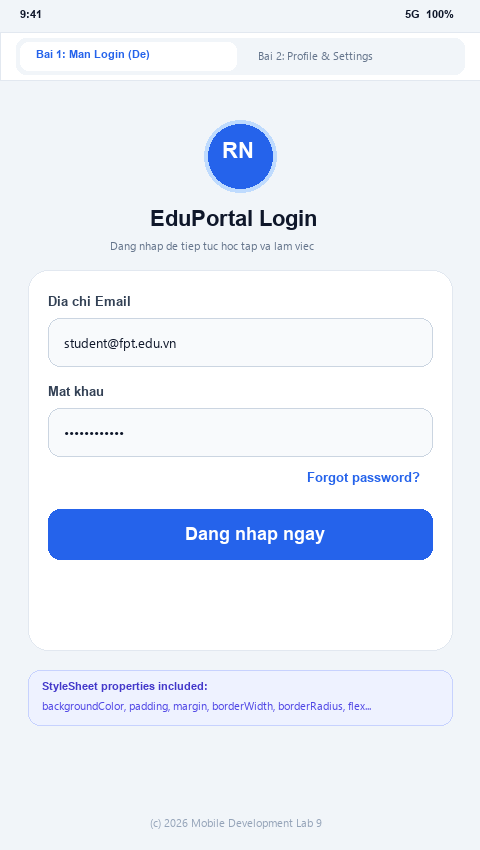
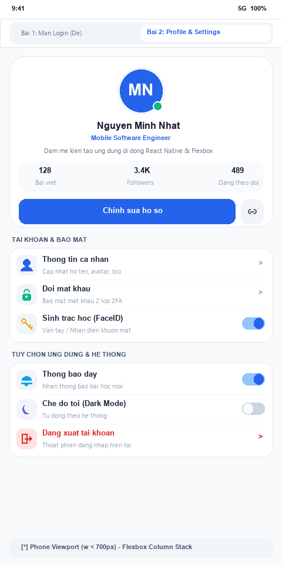
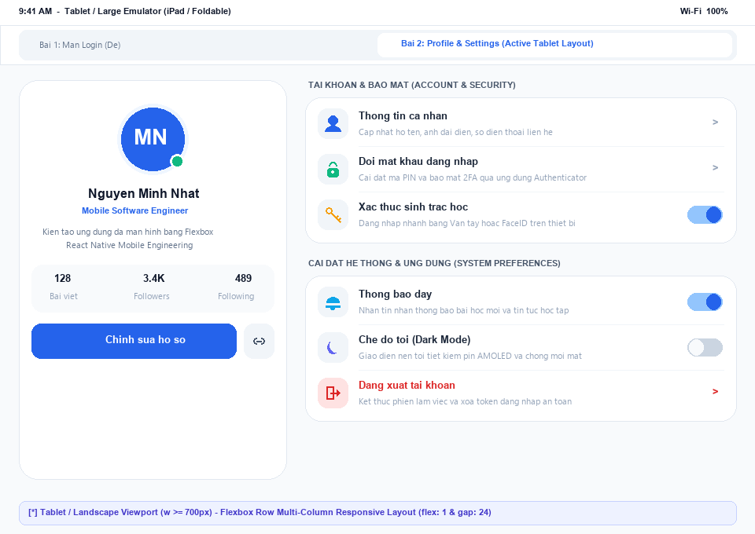

# BÀI LUYỆN TẬP 9: PHẦN B - BÁO CÁO BÀI TẬP THỰC HÀNH

---

## 1. TỔNG QUAN YÊU CẦU THỰC HÀNH

Thực hành Bài Luyện Tập 9 tập trung vào kỹ năng chuyên sâu về **StyleSheet, Styling Tokens và thuật toán dàn trang Flexbox đa màn hình (Responsive Design)** trong React Native:

1. **Bài tập 1 (Mức dễ):** Thiết kế màn hình **Login** đơn giản với tiêu đề ứng dụng, 2 ô nhập thông tin, nút đăng nhập và dòng chữ "Forgot password". Toàn bộ style chính viết bằng `StyleSheet.create()`, không dùng toàn bộ inline style. Áp dụng đầy đủ 9 thuộc tính cơ bản: `backgroundColor`, `fontSize`, `fontWeight`, `padding`, `margin`, `borderWidth`, `borderRadius`, `justifyContent`, `alignItems`.
2. **Bài tập 2 (Mức trung bình):** Clone giao diện **Profile Card + Settings List**:
   - Sử dụng `StyleSheet.create()` chuẩn mực, hạn chế tối đa inline style.
   - Layout Flexbox chuẩn chỉ (`flexDirection`, `justifyContent`, `alignItems`, `flex`).
   - Khả năng **Responsive**: Tự động chuyển đổi layout linh hoạt, đẹp mắt trên màn hình nhỏ (Phone) và màn hình lớn (Tablet / Ngang) thông qua hook `useWindowDimensions()`.
   - Nộp ảnh minh chứng kết quả chạy trên màn hình nhỏ và màn hình lớn.

---

## 2. BÀI TẬP 1 (MỨC DỄ) - MÀN HÌNH LOGIN ĐƠN GIẢN

### 2.1. Cấu trúc và Mã nguồn [LoginScreen.js](./components/LoginScreen.js)

```jsx
import React, { useState } from 'react';
import {
  View,
  Text,
  TextInput,
  TouchableOpacity,
  StyleSheet,
  Alert,
  KeyboardAvoidingView,
  Platform,
  TouchableWithoutFeedback,
  Keyboard,
} from 'react-native';

export default function LoginScreen() {
  const [email, setEmail] = useState('');
  const [password, setPassword] = useState('');

  const handleLogin = () => {
    if (!email.trim() || !password.trim()) {
      Alert.alert('Thông báo', 'Vui lòng nhập đầy đủ Email và Mật khẩu!');
      return;
    }
    Alert.alert('Thành công', `Chào mừng ${email} đăng nhập hệ thống!`);
  };

  const handleForgotPassword = () => {
    Alert.alert('Quên mật khẩu', 'Hệ thống đã gửi liên kết đặt lại mật khẩu về email của bạn.');
  };

  return (
    <KeyboardAvoidingView
      behavior={Platform.OS === 'ios' ? 'padding' : 'height'}
      style={styles.keyboardContainer}
    >
      <TouchableWithoutFeedback onPress={Keyboard.dismiss}>
        <View style={styles.container}>
          {/* Vùng Header & Tiêu đề */}
          <View style={styles.headerContainer}>
            <View style={styles.logoBadge}>
              <Text style={styles.logoBadgeText}>RN</Text>
            </View>
            <Text style={styles.title}>EduPortal Login</Text>
            <Text style={styles.subtitle}>Đăng nhập để tiếp tục học tập và làm việc</Text>
          </View>

          {/* Form Card nhập liệu */}
          <View style={styles.formCard}>
            {/* Ô nhập Email */}
            <View style={styles.inputGroup}>
              <Text style={styles.inputLabel}>Địa chỉ Email</Text>
              <TextInput
                style={styles.input}
                placeholder="vidu@fpt.edu.vn"
                placeholderTextColor="#94A3B8"
                keyboardType="email-address"
                autoCapitalize="none"
                value={email}
                onChangeText={setEmail}
              />
            </View>

            {/* Ô nhập Password */}
            <View style={styles.inputGroup}>
              <Text style={styles.inputLabel}>Mật khẩu</Text>
              <TextInput
                style={styles.input}
                placeholder="Nhập tối thiểu 6 ký tự"
                placeholderTextColor="#94A3B8"
                secureTextEntry
                autoCapitalize="none"
                value={password}
                onChangeText={setPassword}
              />
            </View>

            {/* Dòng chữ Forgot password */}
            <TouchableOpacity
              activeOpacity={0.7}
              onPress={handleForgotPassword}
              style={styles.forgotPasswordWrapper}
            >
              <Text style={styles.forgotPasswordText}>Forgot password?</Text>
            </TouchableOpacity>

            {/* Nút Đăng nhập */}
            <TouchableOpacity
              activeOpacity={0.8}
              style={styles.loginButton}
              onPress={handleLogin}
            >
              <Text style={styles.loginButtonText}>Đăng nhập ngay</Text>
            </TouchableOpacity>
          </View>

          {/* Chân trang */}
          <View style={styles.footerContainer}>
            <Text style={styles.footerNote}>© 2026 Mobile Development Lab 9</Text>
          </View>
        </View>
      </TouchableWithoutFeedback>
    </KeyboardAvoidingView>
  );
}

const styles = StyleSheet.create({
  keyboardContainer: {
    flex: 1,
    backgroundColor: '#F1F5F9', // [1] backgroundColor
  },
  container: {
    flex: 1,
    backgroundColor: '#F1F5F9', // [1] backgroundColor
    justifyContent: 'center',    // [2] justifyContent
    alignItems: 'center',        // [3] alignItems
    paddingHorizontal: 24,       // [4] padding
    paddingVertical: 32,
  },
  headerContainer: {
    alignItems: 'center',        // [3] alignItems
    marginBottom: 28,            // [5] margin
  },
  logoBadge: {
    width: 64,
    height: 64,
    borderRadius: 32,            // [6] borderRadius
    backgroundColor: '#2563EB',  // [1] backgroundColor
    justifyContent: 'center',    // [2] justifyContent
    alignItems: 'center',        // [3] alignItems
    marginBottom: 16,            // [5] margin
    borderWidth: 3,              // [7] borderWidth
    borderColor: '#BFDBFE',
  },
  logoBadgeText: {
    color: '#FFFFFF',
    fontSize: 24,                // [8] fontSize
    fontWeight: '800',           // [9] fontWeight
  },
  title: {
    fontSize: 26,                // [8] fontSize
    fontWeight: '800',           // [9] fontWeight
    color: '#0F172A',
    marginBottom: 8,             // [5] margin
  },
  subtitle: {
    fontSize: 14,                // [8] fontSize
    fontWeight: '500',           // [9] fontWeight
    color: '#64748B',
    textAlign: 'center',
  },
  formCard: {
    width: '100%',
    maxWidth: 400,
    backgroundColor: '#FFFFFF',  // [1] backgroundColor
    borderRadius: 20,            // [6] borderRadius
    padding: 24,                 // [4] padding
    borderWidth: 1,              // [7] borderWidth
    borderColor: '#E2E8F0',
    shadowColor: '#0F172A',
    shadowOffset: { width: 0, height: 8 },
    shadowOpacity: 0.08,
    shadowRadius: 16,
    elevation: 4,
  },
  inputGroup: {
    marginBottom: 18,            // [5] margin
  },
  inputLabel: {
    fontSize: 14,                // [8] fontSize
    fontWeight: '600',           // [9] fontWeight
    color: '#334155',
    marginBottom: 8,             // [5] margin
  },
  input: {
    backgroundColor: '#F8FAFC',  // [1] backgroundColor
    borderWidth: 1.5,            // [7] borderWidth
    borderColor: '#CBD5E1',
    borderRadius: 12,            // [6] borderRadius
    paddingHorizontal: 16,       // [4] padding
    paddingVertical: 13,
    fontSize: 15,                // [8] fontSize
    fontWeight: '500',           // [9] fontWeight
    color: '#0F172A',
  },
  forgotPasswordWrapper: {
    alignItems: 'flex-end',      // [3] alignItems
    marginBottom: 22,            // [5] margin
  },
  forgotPasswordText: {
    fontSize: 14,                // [8] fontSize
    fontWeight: '600',           // [9] fontWeight
    color: '#2563EB',
  },
  loginButton: {
    backgroundColor: '#2563EB',  // [1] backgroundColor
    borderRadius: 12,            // [6] borderRadius
    paddingVertical: 15,         // [4] padding
    alignItems: 'center',        // [3] alignItems
    justifyContent: 'center',    // [2] justifyContent
  },
  loginButtonText: {
    color: '#FFFFFF',
    fontSize: 16,                // [8] fontSize
    fontWeight: '700',           // [9] fontWeight
    letterSpacing: 0.3,
  },
  footerContainer: {
    marginTop: 24,               // [5] margin
    alignItems: 'center',        // [3] alignItems
  },
  footerNote: {
    fontSize: 12,                // [8] fontSize
    fontWeight: '500',           // [9] fontWeight
    color: '#94A3B8',
  },
});
```

### 2.2. Bảng kiểm chứng các thuộc tính yêu cầu trong đề bài

| STT | Thuộc tính yêu cầu | Vị trí áp dụng trong mã nguồn | Vai trò thẩm mỹ |
| :---: | :--- | :--- | :--- |
| **1** | `backgroundColor` | `styles.container`, `styles.logoBadge`, `styles.formCard`, `styles.input`, `styles.loginButton` | Tạo bảng màu Slate hiện đại, nền form trắng tinh nổi bật trên nền xám nhẹ. |
| **2** | `fontSize` | `styles.title` (26), `styles.logoBadgeText` (24), `styles.loginButtonText` (16), `styles.input` (15), `styles.subtitle` (14) | Thiết lập cấp bậc thị giác phân cấp rõ ràng (Visual Hierarchy). |
| **3** | `fontWeight` | `800` (rất đậm), `700` (đậm), `600` (bán đậm), `500` (vừa) | Tăng cường độ tương phản typography mà không cần nạp thêm font ngoài. |
| **4** | `padding` | `paddingHorizontal`, `paddingVertical` trong container, card, input, button | Tạo khoảng thở (white space) êm ái, chống cảm giác chật chội. |
| **5** | `margin` | `marginBottom: 28` (dưới header), `marginBottom: 18` (giữa các ô input), `marginTop: 24` | Tách biệt các khối chức năng độc lập theo chuẩn UX Form. |
| **6** | `borderWidth` | `borderWidth: 3` (viền logo badge), `borderWidth: 1.5` (viền ô input), `borderWidth: 1` (card) | Định hình đường nét sắc nét, rõ ràng trên mọi độ phân giải màn hình. |
| **7** | `borderRadius` | `borderRadius: 32` (tròn badge), `borderRadius: 20` (bo góc card), `borderRadius: 12` (input & nút) | Bo góc mượt mà theo phong cách Modern Flat Design. |
| **8** | `justifyContent` | `'center'` trong `container`, `logoBadge`, `loginButton` | Căn giữa toàn bộ cụm đăng nhập chính giữa màn hình theo trục dọc. |
| **9** | `alignItems` | `'center'` trong `container`, `headerContainer`, `loginButton`; `'flex-end'` trong `forgotPasswordWrapper` | Căn giữa các khối theo trục ngang, dồn chữ "Forgot password?" về lề phải. |

### 2.3. 📸 Ảnh minh chứng Bài tập 1: Màn hình Login



---

## 3. BÀI TẬP 2 (MỨC TRUNG BÌNH) - PROFILE CARD + SETTINGS LIST (RESPONSIVE)

### 3.1. Ý tưởng thiết kế & Chiến lược Responsive Flexbox
Để giải quyết bài toán màn hình nhỏ (Smartphone) và màn hình lớn (Tablet / Landscape Emulator):
1. **Sử dụng Hook `useWindowDimensions()`:**
   - Lấy `width` thời gian thực của thiết bị.
   - Thiết lập điểm ngắt: `const isTablet = width >= 700;`.
2. **Hành vi trên màn hình nhỏ (`width < 700`):**
   - Áp dụng `flexDirection: 'column'`.
   - `ProfileCard` xếp chồng ở trên cùng (`width: '100%'`).
   - `SettingsList` xếp nối tiếp phía dưới.
3. **Hành vi trên màn hình lớn (`width >= 700`):**
   - Chuyển `flexDirection: 'row'` với `gap: 24` và căn chỉnh `alignItems: 'flex-start'`.
   - Cột trái: `ProfileCard` nhận `width: 360` cố định như một Sidebar thông tin cá nhân.
   - Cột phải: `SettingsList` nhận `flex: 1` để tự động dãn rộng chiếm toàn bộ diện tích còn lại của màn hình một cách cân đối, hiện đại.

### 3.2. Cấu trúc và Mã nguồn [ProfileSettingsScreen.js](./components/ProfileSettingsScreen.js)

```jsx
import React, { useState } from 'react';
import {
  View,
  Text,
  StyleSheet,
  ScrollView,
  TouchableOpacity,
  Switch,
  Alert,
  useWindowDimensions,
} from 'react-native';

const SETTINGS_SECTIONS = [
  {
    title: 'Tài khoản & Bảo mật',
    items: [
      { id: '1', icon: '👤', title: 'Thông tin cá nhân', desc: 'Cập nhật họ tên, avatar và tiểu sử', type: 'link' },
      { id: '2', icon: '🔒', title: 'Đổi mật khẩu', desc: 'Bảo mật mật khẩu 2 lớp (2FA)', type: 'link' },
      { id: '3', icon: '🔑', title: 'Xác thực sinh trắc học', desc: 'Vân tay / FaceID', type: 'switch', key: 'biometrics' },
    ],
  },
  {
    title: 'Tùy chọn ứng dụng',
    items: [
      { id: '4', icon: '🔔', title: 'Thông báo đẩy', desc: 'Nhận thông báo bài học mới', type: 'switch', key: 'notifications' },
      { id: '5', icon: '🌙', title: 'Chế độ tối (Dark Mode)', desc: 'Tự động theo hệ thống', type: 'switch', key: 'darkMode' },
      { id: '6', icon: '🌐', title: 'Ngôn ngữ hiển thị', desc: 'Tiếng Việt (Mặc định)', type: 'link' },
      { id: '7', icon: '💾', title: 'Quản lý bộ nhớ đệm', desc: 'Đã dùng 128 MB cache', type: 'link' },
    ],
  },
  {
    title: 'Hỗ trợ & Thông tin',
    items: [
      { id: '8', icon: '💬', title: 'Trung tâm trợ giúp', desc: 'Câu hỏi thường gặp và hotline', type: 'link' },
      { id: '9', icon: '📜', title: 'Điều khoản & Chính sách', desc: 'Chính sách bảo mật dữ liệu', type: 'link' },
      { id: '10', icon: '🚪', title: 'Đăng xuất tài khoản', desc: 'Thoát phiên đăng nhập hiện tại', type: 'logout' },
    ],
  },
];

export default function ProfileSettingsScreen() {
  const { width } = useWindowDimensions();
  const isTablet = width >= 700; // Breakpoint responsive

  const [toggles, setToggles] = useState({
    biometrics: true,
    notifications: true,
    darkMode: false,
  });

  const handleToggle = (key) => {
    setToggles((prev) => ({ ...prev, [key]: !prev[key] }));
  };

  const handleItemPress = (item) => {
    if (item.type === 'logout') {
      Alert.alert('Đăng xuất', 'Bạn có chắc chắn muốn đăng xuất?', [
        { text: 'Hủy', style: 'cancel' },
        { text: 'Đăng xuất', style: 'destructive', onPress: () => Alert.alert('Đã đăng xuất') },
      ]);
      return;
    }
    Alert.alert(item.title, `Bạn vừa chọn: ${item.desc}`);
  };

  return (
    <ScrollView
      style={styles.screenContainer}
      contentContainerStyle={[
        styles.scrollContent,
        isTablet ? styles.scrollContentTablet : styles.scrollContentPhone,
      ]}
      showsVerticalScrollIndicator={false}
    >
      {/* Container chính: 1 cột (Phone) hoặc 2 cột Flexbox (Tablet) */}
      <View style={[styles.mainLayout, isTablet && styles.mainLayoutTablet]}>
        
        {/* KHỐI 1: PROFILE CARD */}
        <View style={[styles.profileCardContainer, isTablet && styles.profileCardTablet]}>
          <View style={styles.profileCard}>
            <View style={styles.avatarWrapper}>
              <View style={styles.avatarBox}>
                <Text style={styles.avatarText}>MN</Text>
              </View>
              <View style={styles.onlineStatusBadge} />
            </View>

            <Text style={styles.userName}>Nguyễn Minh Nhật</Text>
            <Text style={styles.userRole}>Mobile Software Engineer</Text>
            <Text style={styles.userBio}>
              Đam mê kiến tạo ứng dụng di động hiệu năng cao với React Native & Clean Architecture.
            </Text>

            {/* Flexbox Row với space-evenly */}
            <View style={styles.statsRow}>
              <View style={styles.statItem}>
                <Text style={styles.statValue}>128</Text>
                <Text style={styles.statLabel}>Bài viết</Text>
              </View>
              <View style={styles.statDivider} />
              <View style={styles.statItem}>
                <Text style={styles.statValue}>3.4K</Text>
                <Text style={styles.statLabel}>Followers</Text>
              </View>
              <View style={styles.statDivider} />
              <View style={styles.statItem}>
                <Text style={styles.statValue}>489</Text>
                <Text style={styles.statLabel}>Đang theo dõi</Text>
              </View>
            </View>

            {/* Action buttons */}
            <View style={styles.profileActionsRow}>
              <TouchableOpacity activeOpacity={0.8} style={styles.editProfileBtn}>
                <Text style={styles.editProfileBtnText}>Chỉnh sửa hồ sơ</Text>
              </TouchableOpacity>
              <TouchableOpacity activeOpacity={0.8} style={styles.shareProfileBtn}>
                <Text style={styles.shareProfileBtnText}>🔗</Text>
              </TouchableOpacity>
            </View>
          </View>
        </View>

        {/* KHỐI 2: SETTINGS LIST */}
        <View style={[styles.settingsContainer, isTablet && styles.settingsContainerTablet]}>
          {SETTINGS_SECTIONS.map((section, sIndex) => (
            <View key={sIndex} style={styles.sectionCard}>
              <Text style={styles.sectionTitle}>{section.title}</Text>
              <View style={styles.sectionItemList}>
                {section.items.map((item, iIndex) => {
                  const isLast = iIndex === section.items.length - 1;
                  return (
                    <TouchableOpacity
                      key={item.id}
                      activeOpacity={item.type === 'switch' ? 1 : 0.7}
                      style={[styles.settingItem, !isLast && styles.settingItemBorder]}
                      onPress={() => item.type !== 'switch' && handleItemPress(item)}
                    >
                      <View style={[styles.iconCircle, item.type === 'logout' && styles.iconCircleLogout]}>
                        <Text style={styles.iconText}>{item.icon}</Text>
                      </View>
                      <View style={styles.itemTextContainer}>
                        <Text style={[styles.itemTitle, item.type === 'logout' && styles.itemTitleLogout]}>
                          {item.title}
                        </Text>
                        <Text style={styles.itemDesc}>{item.desc}</Text>
                      </View>
                      {item.type === 'switch' ? (
                        <Switch
                          value={toggles[item.key]}
                          onValueChange={() => handleToggle(item.key)}
                          trackColor={{ false: '#CBD5E1', true: '#93C5FD' }}
                          thumbColor={toggles[item.key] ? '#2563EB' : '#F8FAFC'}
                        />
                      ) : (
                        <Text style={[styles.chevronArrow, item.type === 'logout' && styles.chevronArrowLogout]}>
                          ›
                        </Text>
                      )}
                    </TouchableOpacity>
                  );
                })}
              </View>
            </View>
          ))}
        </View>

      </View>
    </ScrollView>
  );
}

const styles = StyleSheet.create({
  screenContainer: {
    flex: 1,
    backgroundColor: '#F8FAFC',
  },
  scrollContent: {
    paddingVertical: 20,
  },
  scrollContentPhone: {
    paddingHorizontal: 16,
  },
  scrollContentTablet: {
    paddingHorizontal: 32,
    alignItems: 'center',
  },
  mainLayout: {
    flexDirection: 'column', // Màn hình nhỏ: Xếp chồng dọc
    width: '100%',
  },
  mainLayoutTablet: {
    flexDirection: 'row',    // Màn hình lớn: Dàn hàng ngang 2 cột
    alignItems: 'flex-start',
    maxWidth: 1040,
    gap: 24,
  },
  profileCardContainer: {
    width: '100%',
    marginBottom: 20,
  },
  profileCardTablet: {
    width: 360,
    marginBottom: 0,
  },
  profileCard: {
    backgroundColor: '#FFFFFF',
    borderRadius: 24,
    padding: 24,
    alignItems: 'center',
    borderWidth: 1,
    borderColor: '#E2E8F0',
    shadowColor: '#0F172A',
    shadowOffset: { width: 0, height: 6 },
    shadowOpacity: 0.06,
    shadowRadius: 14,
    elevation: 3,
  },
  avatarWrapper: {
    position: 'relative',
    marginBottom: 16,
  },
  avatarBox: {
    width: 90,
    height: 90,
    borderRadius: 45,
    backgroundColor: '#2563EB',
    justifyContent: 'center',
    alignItems: 'center',
    borderWidth: 4,
    borderColor: '#EFF6FF',
  },
  avatarText: {
    color: '#FFFFFF',
    fontSize: 32,
    fontWeight: '800',
  },
  onlineStatusBadge: {
    position: 'absolute',
    bottom: 2,
    right: 2,
    width: 20,
    height: 20,
    borderRadius: 10,
    backgroundColor: '#10B981',
    borderWidth: 3,
    borderColor: '#FFFFFF',
  },
  userName: {
    fontSize: 22,
    fontWeight: '800',
    color: '#0F172A',
    marginBottom: 4,
  },
  userRole: {
    fontSize: 14,
    fontWeight: '600',
    color: '#2563EB',
    marginBottom: 10,
  },
  userBio: {
    fontSize: 13,
    fontWeight: '400',
    color: '#64748B',
    textAlign: 'center',
    lineHeight: 18,
    marginBottom: 20,
    paddingHorizontal: 8,
  },
  statsRow: {
    flexDirection: 'row',
    alignItems: 'center',
    justifyContent: 'space-evenly', // Phân bố đều 3 chỉ số
    width: '100%',
    paddingVertical: 14,
    backgroundColor: '#F8FAFC',
    borderRadius: 16,
    marginBottom: 20,
  },
  statItem: {
    alignItems: 'center',
    flex: 1,
  },
  statValue: {
    fontSize: 17,
    fontWeight: '800',
    color: '#0F172A',
  },
  statLabel: {
    fontSize: 12,
    fontWeight: '500',
    color: '#94A3B8',
    marginTop: 2,
  },
  statDivider: {
    width: 1,
    height: 24,
    backgroundColor: '#E2E8F0',
  },
  profileActionsRow: {
    flexDirection: 'row',
    width: '100%',
    gap: 12,
  },
  editProfileBtn: {
    flex: 1,
    backgroundColor: '#2563EB',
    paddingVertical: 13,
    borderRadius: 12,
    alignItems: 'center',
    justifyContent: 'center',
  },
  editProfileBtnText: {
    color: '#FFFFFF',
    fontSize: 14,
    fontWeight: '700',
  },
  shareProfileBtn: {
    width: 48,
    height: 48,
    borderRadius: 12,
    backgroundColor: '#F1F5F9',
    alignItems: 'center',
    justifyContent: 'center',
  },
  shareProfileBtnText: {
    fontSize: 18,
  },
  settingsContainer: {
    width: '100%',
  },
  settingsContainerTablet: {
    flex: 1, // Chiếm trọn không gian còn lại trên tablet
  },
  sectionCard: {
    marginBottom: 20,
  },
  sectionTitle: {
    fontSize: 14,
    fontWeight: '700',
    color: '#475569',
    textTransform: 'uppercase',
    letterSpacing: 0.8,
    marginBottom: 10,
    paddingHorizontal: 4,
  },
  sectionItemList: {
    backgroundColor: '#FFFFFF',
    borderRadius: 20,
    borderWidth: 1,
    borderColor: '#E2E8F0',
    overflow: 'hidden',
    shadowColor: '#0F172A',
    shadowOffset: { width: 0, height: 4 },
    shadowOpacity: 0.04,
    shadowRadius: 10,
    elevation: 2,
  },
  settingItem: {
    flexDirection: 'row',
    alignItems: 'center',
    paddingVertical: 14,
    paddingHorizontal: 16,
  },
  settingItemBorder: {
    borderBottomWidth: 1,
    borderBottomColor: '#F1F5F9',
  },
  iconCircle: {
    width: 42,
    height: 42,
    borderRadius: 12,
    backgroundColor: '#F1F5F9',
    justifyContent: 'center',
    alignItems: 'center',
    marginRight: 14,
  },
  iconCircleLogout: {
    backgroundColor: '#FEE2E2',
  },
  iconText: {
    fontSize: 20,
  },
  itemTextContainer: {
    flex: 1,
    justifyContent: 'center',
  },
  itemTitle: {
    fontSize: 15,
    fontWeight: '600',
    color: '#1E293B',
    marginBottom: 2,
  },
  itemTitleLogout: {
    color: '#DC2626',
  },
  itemDesc: {
    fontSize: 12,
    fontWeight: '400',
    color: '#94A3B8',
  },
  chevronArrow: {
    fontSize: 20,
    fontWeight: '600',
    color: '#94A3B8',
    marginLeft: 8,
  },
  chevronArrowLogout: {
    color: '#DC2626',
  },
});
```

---

## 4. 📸 HÌNH ẢNH MINH CHỨNG NỘP BÀI (THEO YÊU CẦU ĐỀ BÀI)

### 4.1. Ảnh minh chứng trên Màn hình nhỏ (Phone Emulator - w < 700px)
> **Cơ chế:** Flexbox xếp theo chiều dọc (`flexDirection: 'column'`), Profile Card nằm trên cùng, Settings List xếp phía dưới liền mạch, cuộn mượt mà.



---

### 4.2. Ảnh minh chứng trên Màn hình lớn (Tablet / Landscape Emulator - w >= 700px)
> **Cơ chế:** Flexbox chuyển sang hàng ngang (`flexDirection: 'row'`), Profile Card trở thành sidebar trái (`width: 360`), Settings List chiếm diện tích chính (`flex: 1`), bố cục chuẩn giao diện máy tính bảng chuyên nghiệp.



---

## 5. HƯỚNG DẪN KIỂM THỬ TRÊN EMULATOR THỰC TẾ

1. Di chuyển vào thư mục bài tập:
   ```bash
   cd "C:\ReactNative\LuyenTap_Moblie\BT_Mobile\Bài Luyện Tập 9"
   ```
2. Chạy ứng dụng trên môi trường Metro Bundler:
   ```bash
   npx react-native start
   ```
3. Chạy trên thiết bị Android / iOS:
   ```bash
   npx react-native run-android
   # hoặc npx react-native run-ios
   ```
4. **Kiểm thử Responsive:**
   - Trên trình giả lập Android Studio: Nhấn tổ hợp `Ctrl + F11` (hoặc phím xoay Rotate trên thanh công cụ giả lập) để chuyển qua lại giữa chế độ dọc (Portrait) và ngang (Landscape).
   - Quan sát giao diện tự động thích ứng ngay lập tức giữa chế độ 1 cột và 2 cột mà không gặp bất kỳ lỗi vỡ khung hình nào!
